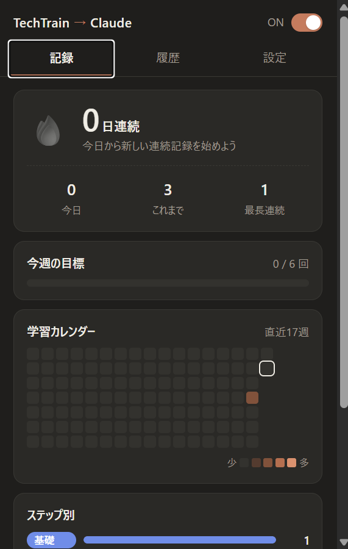
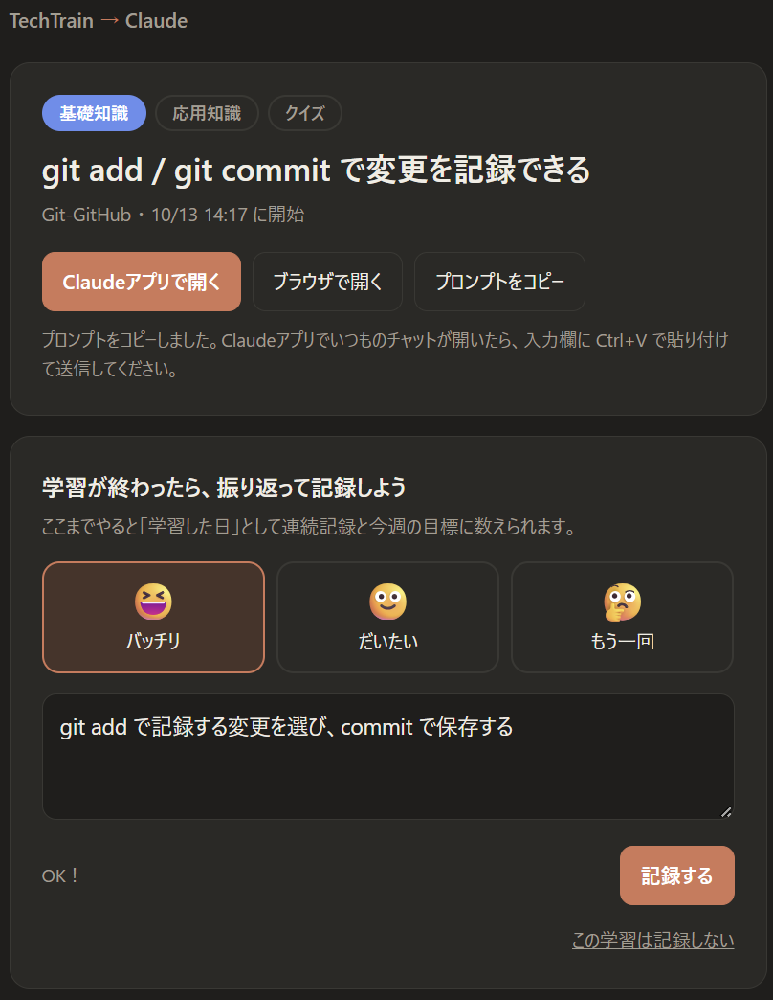

# TechTrain → Claude

TechTrainの学習ページにある「プロンプトを生成」ボタンを、ChatGPTではなく **Claude** で開けるようにするChrome拡張機能です。
あわせて、**振り返りまで終えた学習だけ**を記録し、連続学習日数や学習カレンダーでモチベーションを保てるようにしました。

> TechTrain・Claude・ChatGPTの公式ツールではありません。個人で作った非公式の拡張機能です。
> 公開にあたっては、TechTrain運営の方に確認し、了承をいただいています。

<!-- スクリーンショットを docs フォルダに入れたら、下のコメントを外してください


-->

## 作った理由

TechTrainには、AIに渡すプロンプトをボタン1つで作ってくれる機能があります。ただ、ボタンを押すと毎回ChatGPTの新しいチャットが開きます。

私はClaudeの有料プランを使っているので、毎回プロンプトをコピーしてClaudeに貼り直すのが手間でした。
また、学習が続かないことも悩みだったので、「学習した記録が目に見える仕組み」もほしいと思い、作りました。

## できること

- **Claudeで開く**：「プロンプトを生成」を押すと、ChatGPTの代わりにClaudeが開き、プロンプトが入力された状態になる
  - デスクトップアプリ／ブラウザ版のどちらでも開ける
  - 毎回新しいチャット、または決めておいたチャット・プロジェクトで開ける
- **振り返ったら記録**：学習後に「理解度（3段階）」と「わかったことを一言」を書くと、1回の学習として記録される
- **学習ログ**：連続学習日数、今週の目標、GitHub風の学習カレンダー、基礎／応用／クイズの内訳、よく学んだ技術
- **履歴**：振り返りメモを検索でき、同じプロンプトでもう一度Claudeを開ける

## 工夫したところ・改良の経緯

使いながら気づいた問題を、1つずつ直していきました。

| バージョン | 気づいた問題 | 対応 |
| --- | --- | --- |
| 1.0 | ― | ChatGPTへの移動を検知してClaudeに転送。開いた回数を記録 |
| 1.1 | ブラウザではなくデスクトップアプリで使いたい | Claudeアプリのリンク（`claude://`）で開けるようにした |
| 1.1 | 開くだけで記録が増えるので、連続記録に意味がない | 理解度と一言メモを書いて初めて「学習した」と数える方式に変更 |
| 1.2 | プロジェクトだけでなく、決まったチャットで開きたい | チャットのURLも登録できるようにし、設定を「使うClaude」と「開く場所」に分けた |
| 1.2.1 | アプリの既存チャットではプロンプトが入らない | アプリのリンクの制限だったため、自動でコピーして貼り付けてもらう方式に |
| 1.3 | 「応用」で開いても「基礎」と記録される | 拡張機能の更新後に、開いていたページでボタンの検知が止まっていた。更新時に読み込み直す処理と、手動で直せる機能を追加 |

特に1.1の変更は、「記録が増えること」ではなく「実際に学んだこと」をモチベーションにしたいと考えて決めました。
一言メモを自分の言葉で書くことで、学んだ内容を思い出す練習にもなります。

## 仕組み

```
TechTrain ──(プロンプトを生成)──▶ chatgpt.com/?prompt=… へ移動しようとする
                                       │
                         background.js が移動を検知してプロンプトを取り出す
                                       │
                ┌──────────────────────┴──────────────────────┐
         デスクトップアプリ                                  ブラウザ
   学習ページ（study.html）を表示し              claude.ai/new?q=… を開く
   claude://claude.ai/new?q=… でアプリを起動      （既存チャットでは claude.js が入力）
```

| ファイル | 役割 |
| --- | --- |
| `manifest.json` | 拡張機能の設定（Manifest V3） |
| `background.js` | ChatGPTへの移動を検知して転送する。記録の保存、アイコンの数字の更新 |
| `techtrain.js` | TechTrainのページで、どのボタン（基礎／応用／クイズ）が押されたかを読み取る |
| `claude.js` | ブラウザ版Claudeで、入力欄にプロンプトを入れる |
| `study.html` / `study.js` | 学習ページ。アプリの起動と振り返りの入力 |
| `popup.html` / `popup.js` | アイコンを押したときの画面（記録・履歴・設定） |
| `lib.js` | 共通の処理（URLの組み立て、連続日数の計算など） |

使った技術：JavaScript、Chrome拡張機能（Manifest V3）、`chrome.webNavigation`、`chrome.storage`、コンテンツスクリプト

## 入れ方

1. このリポジトリをダウンロードする（緑の「Code」→「Download ZIP」）して解凍する
2. Chromeで `chrome://extensions` を開く
3. 右上の「デベロッパーモード」をオンにする
4. 「パッケージ化されていない拡張機能を読み込む」で、このフォルダを選ぶ

## 使い方

1. TechTrainで「プロンプトを生成」を押す
2. Claudeが開くので学習する（初回はChromeに「Claude を開きますか？」と出るので「常に許可」）
3. 学習が終わったら、学習ページで理解度と一言メモを書いて「記録する」
4. 拡張機能のアイコンから、記録や履歴を見る

- 開く場所に「いつものチャット」を選び、デスクトップアプリで開く場合、プロンプトは自動でコピーされます。入力欄に `Ctrl+V` で貼り付けてください（アプリのリンクの仕様で、既存のチャットにはプロンプトを渡せないため）
- 記録はそのPCのChromeの中だけに保存されます。設定の「記録を書き出す」でJSONとして保存できます

## 今後やりたいこと

- 振り返りメモを週ごとにまとめて見られるようにする
- 理解度が「もう一回」の学習を、数日後に復習としてお知らせする

## 制作

AI（Claude）と相談しながら制作しました。どこを直すか・どう動くべきかは、自分で使って確かめながら決めています。
